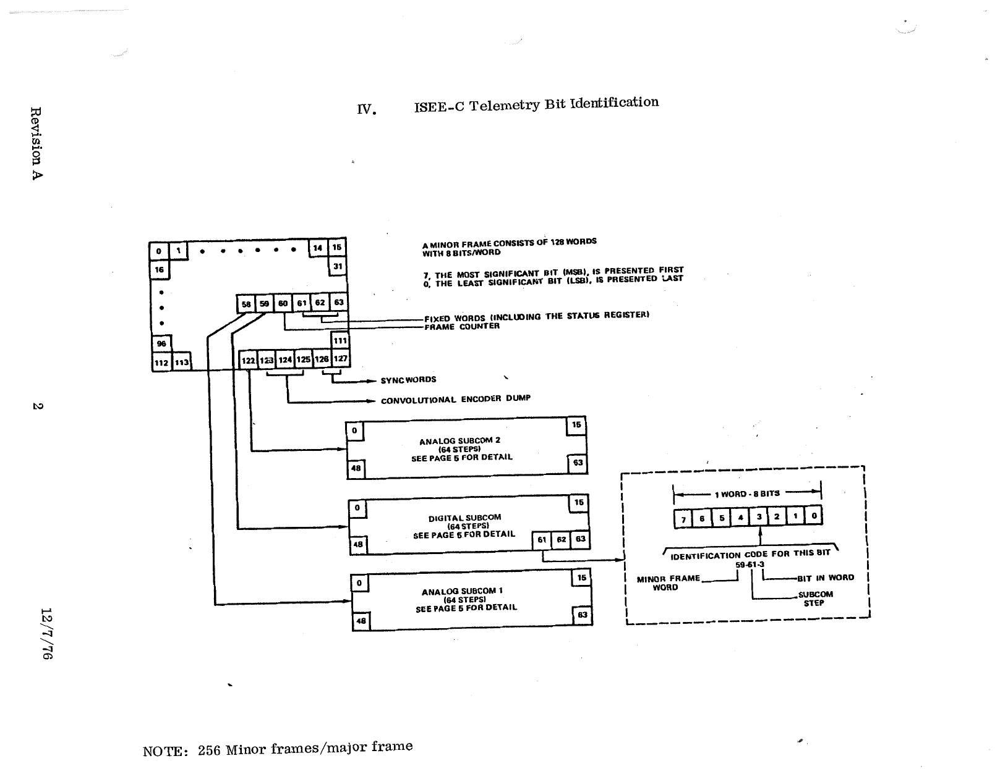

# IV. ISEE-C Telemetry Bit Identification

*Original page 2, Revision A, 12/7/76*

## Content of the diagram

- A minor frame consists of **128 words with 8 bits/word**.
- Bit **7, the most significant bit (MSB), is presented first**. Bit **0, the least significant bit (LSB), is presented last**.
- Words **60–63** are the fixed words, which include the [status register](08-status-register.md) and the frame counter.
- Words **123–125** are the convolutional encoder dump.
- Words **126–127** are the sync words.
- Word **58** is Analog Subcom 1 (64 steps), word **59** is the Digital Subcom (64 steps), and word **122** is Analog Subcom 2 (64 steps). Their detail is in [Section VII](07-subcom-formats.md).
- **Note:** 256 minor frames/major frame.

### Identification code

A bit is identified by a code of the form **minor frame word – subcom step – bit in word**. For example, **59-61-3** is minor frame word 59, subcom step 61, bit 3.
