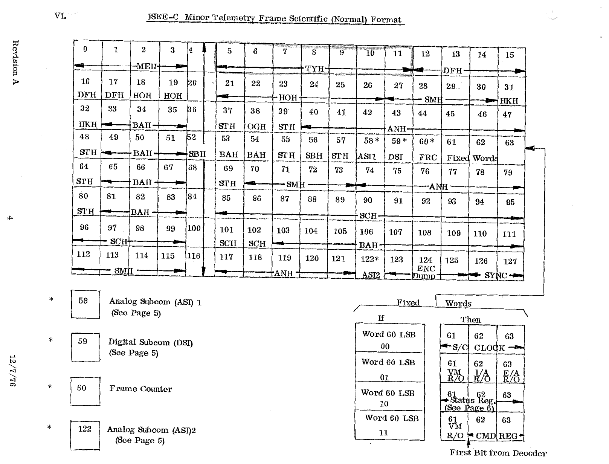

# VI. ISEE-C Minor Telemetry Frame Scientific (Normal) Format

*Original page 4, Revision A, 12/7/76*

The diagram shows the 128-word minor frame as an 8 × 16 grid, with the unit ID that owns each word. The word-by-word assignment is listed in full in [Appendix A](../appendix-a/index.md).

## Special words

Words marked \* in the diagram:

| Word | Content |
|---|---|
| 58 | Analog Subcom (ASI) 1. See [Section VII](07-subcom-formats.md). |
| 59 | Digital Subcom (DSI). See [Section VII](07-subcom-formats.md). |
| 60 | Frame Counter |
| 122 | Analog Subcom (ASI) 2. See [Section VII](07-subcom-formats.md). |

The other special words are: 61–63 are the fixed words, 124 (with 123 and 125) is the ENC Dump, and 126–127 are SYNC.

## Fixed words

The two LSBs of word 60 select the content of words 61, 62 and 63. The diagram marks the CMD REG with the note "First Bit from Decoder".

| If Word 60 LSB = | Word 61 | Word 62 | Word 63 |
|:-:|---|---|---|
| 00 | S/C Clock | S/C Clock | S/C Clock |
| 01 | VM R/O | I/A R/O | E/A R/O |
| 10 | Status Reg (see [page 6](08-status-register.md)) | Status Reg | Status Reg |
| 11 | VM R/O | CMD REG | CMD REG |
