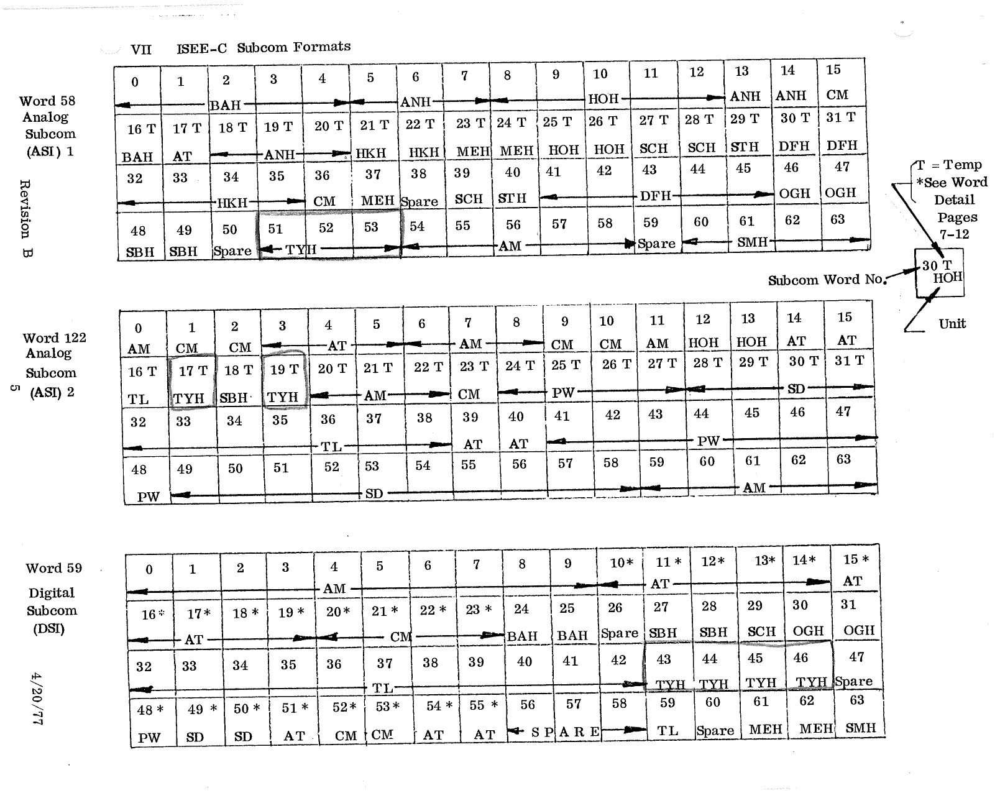

# VII. ISEE-C Subcom Formats

*Original page 5, Revision B, 4/20/77*

The page shows the three 64-step subcommutators as 4 × 16 grids. Each cell carries the subcom word number and its unit ID:

- **Word 58**, Analog Subcom (ASI) 1
- **Word 122**, Analog Subcom (ASI) 2
- **Word 59**, Digital Subcom (DSI)

Diagram legend:

- **T** = Temp
- **\*** = see word detail, pages 7–12 ([Section IX](09-digital-subcom-word-detail.md))
- The example cell "30 T / HOH" means subcom word no. 30, a temperature, unit HOH.

The same assignments are listed with descriptors in [Appendix A](../appendix-a/index.md) under minor frame words 58, 59 and 122.
