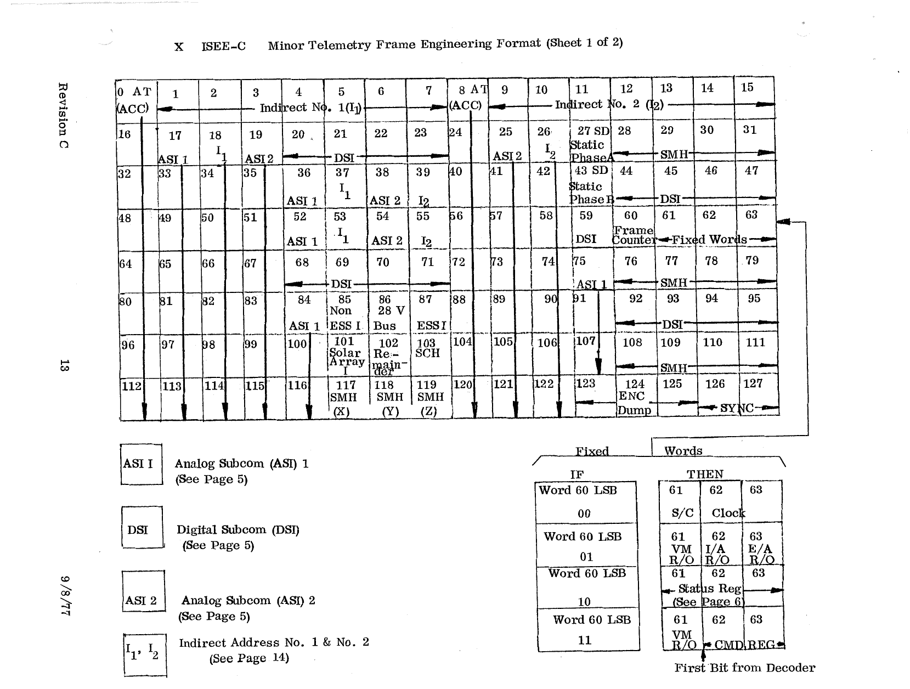

# X. ISEE-C Minor Telemetry Frame Engineering Format

## Sheet 1 of 2

*Original page 13, Revision C, 9/8/77*

In the engineering format, the minor frame is mostly filled with the accelerometer output (AT ACC, every 8th word), the analog and digital subcoms, and the two indirect addresses I1 and I2. The word-by-word assignment is in [Appendix C](../appendix-c/index.md).

Legend from the diagram:

| Label | Meaning |
|---|---|
| ASI 1 | Analog Subcom (ASI) 1 (see [page 5](07-subcom-formats.md)) |
| DSI | Digital Subcom (DSI) (see [page 5](07-subcom-formats.md)) |
| ASI 2 | Analog Subcom (ASI) 2 (see [page 5](07-subcom-formats.md)) |
| I1, I2 | Indirect Address No. 1 & No. 2 (see [page 14](#sheet-2-of-2)) |

The fixed words (60 = Frame Counter, 61–63) follow the same rule as the scientific format. See [Section VI](06-minor-frame-scientific.md#fixed-words).

## Sheet 2 of 2

*Original page 14, Revision A, 12/7/76*

Indirect Address No. 1 (I1) and No. 2 (I2) independently select any of these 16 parameters.

| Address | Unit | Measurement |
|---|---|---|
| AI16 | SCH | 16 Chan f16 (100 KHz) Data |
| AI17 | SCH | 16 Chan f15 (56 KHz) Data |
| AI18 | SCH | 16 Chan f14 (31 KHz) Data |
| AI19 | SCH | 16 Chan f13 (17 KHz) Data |
| AI20 | SCH | 16 Chan f12 (10 KHz) Data |
| AI21 | SD | Static Phase A |
| AI22 | SD | Static Phase B |
| AI23 | AT | Accelerometer Output |
| AI24 | SMH | X-Axis Magnetic Field Data |
| AI25 | SMH | Y-Axis Magnetic Field Data |
| AI26 | SMH | Z-Axis Magnetic Field Data |
| AI27 | PW | Non-Essential Bus Current |
| AI28 | PW | Main Bus Voltage |
| AI29 | PW | Essential Bus Current |
| AI30 | PW | Solar Array Current |
| AI31 | TL | Remainder |
