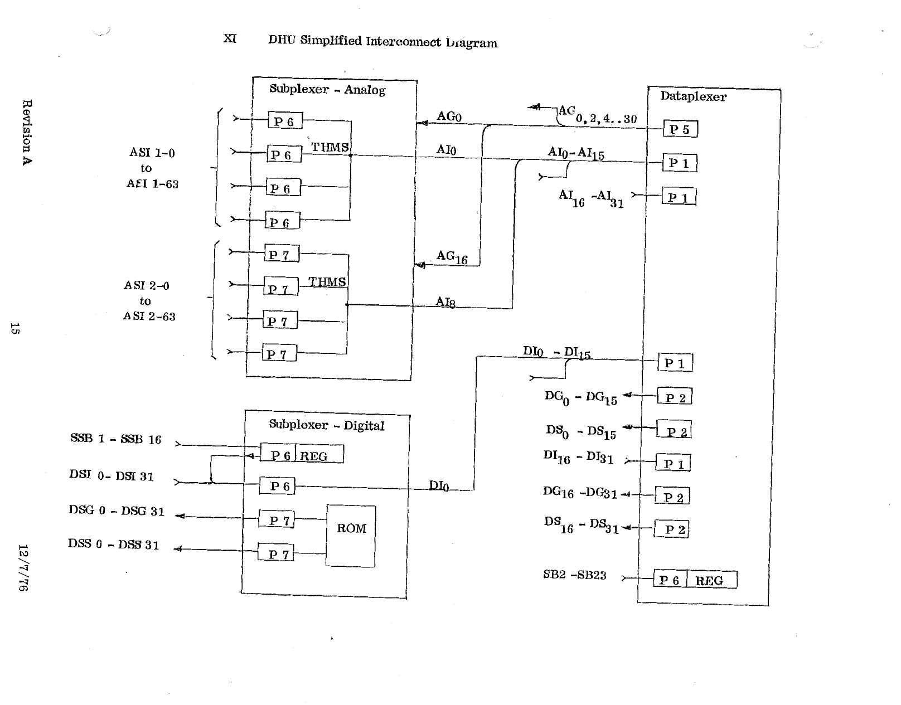

# XI. DHU Simplified Interconnect Diagram

*Original page 15, Revision A, 12/7/76*

The diagram shows how the Data Handling Unit (DHU) is wired:

- **Dataplexer (P1, P2, P5, P6).** Its analog gates AG0,2,4…30, analog inputs AI0–AI15 and AI16–AI31, digital inputs DI0–DI15 and DI16–DI31, digital gates DG0–DG15 and DG16–DG31, digital shifts DS0–DS15 and DS16–DS31, and status bits SB2–SB23 (into REG).
- **Analog subplexer.** Driven by AG0/AI0 for ASI 1-0 to ASI 1-63 (connector P6) and by AG16/AI8 for ASI 2-0 to ASI 2-63 (connector P7). Each half includes thermistor (THMS) inputs.
- **Digital subplexer.** Fed by DI0, with a REG, a ROM, subplexer status bits SSB 1–SSB 16 (P6), digital subplexer inputs DSI 0–DSI 31 (P6), and digital subplexer gate/shift outputs DSG 0–DSG 31 and DSS 0–DSS 31 (P7).

The abbreviations are defined in the [Glossary](15-glossary.md).
