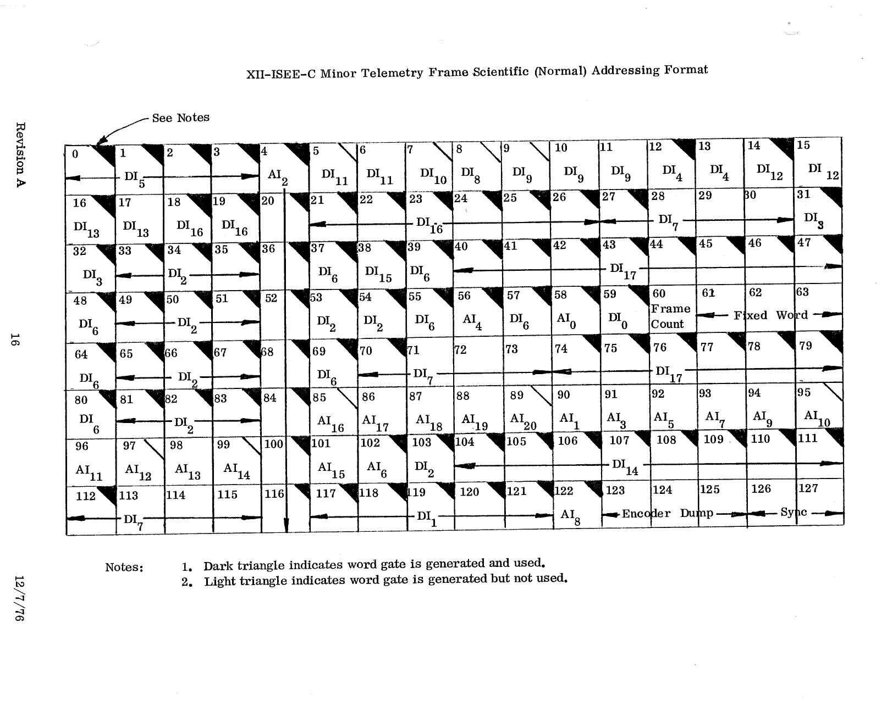

# XII. ISEE-C Minor Telemetry Frame Scientific (Normal) Addressing Format

*Original page 16, Revision A, 12/7/76*

This is the [Section VI](06-minor-frame-scientific.md) minor frame grid, annotated with the DHU address (DIn = digital input, AIn = analog input) that each word is read from. See [Section XI](11-dhu-interconnect.md) for the interconnect.

Notes on the original:

1. A dark triangle indicates the word gate is generated and used.
2. A light triangle indicates the word gate is generated but not used.
