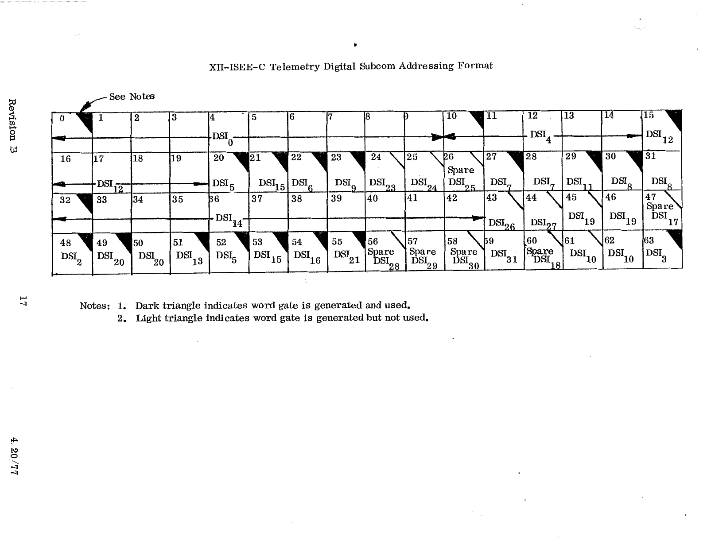

# XIII. ISEE-C Telemetry Digital Subcom Addressing Format

*Original page 17, Revision B, 4/20/77*

This is the 64-step digital subcom (minor frame word 59) annotated with the digital subplexer input (DSIn) each subcom word is read from. Several subcom words (26, 47, 56–58, 60) are marked as spares wired to DSI inputs.

Notes on the original:

1. A dark triangle indicates the word gate is generated and used.
2. A light triangle indicates the word gate is generated but not used.
