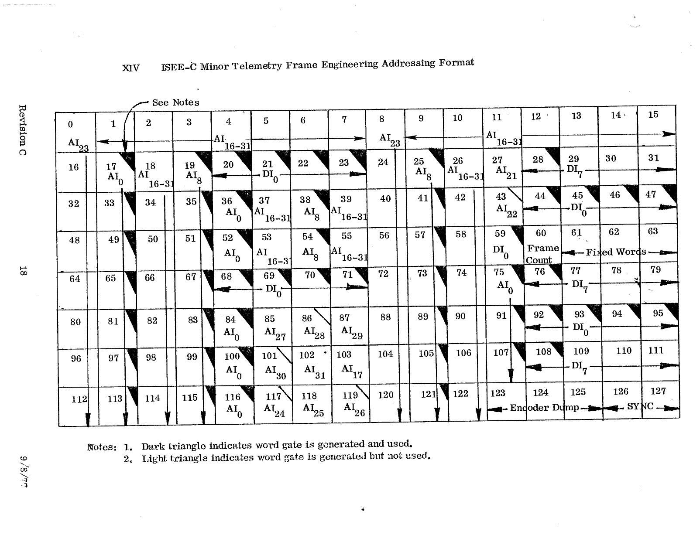

# XIV. ISEE-C Minor Telemetry Frame Engineering Addressing Format

*Original page 18, Revision C, 9/8/77*

This is the [Section X](10-minor-frame-engineering.md) engineering minor frame grid, annotated with the DHU address each word is read from. For example, AI23 is the accelerometer, AI0 is ASI 1, AI8 is ASI 2, DI0 is DSI, AI16–31 is an indirect address, and DI7 is SMH.

Notes on the original:

1. A dark triangle indicates the word gate is generated and used.
2. A light triangle indicates the word gate is generated but not used.
